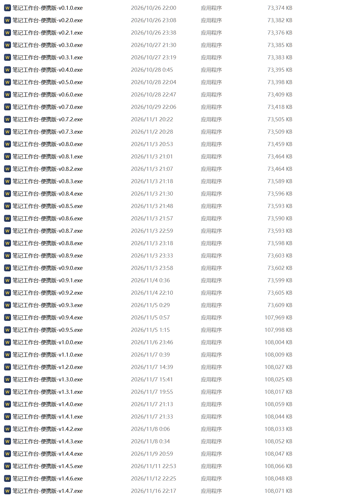

# 小红书笔记工作台｜从一篇稿子到一组能发布的卡片

> 当前本机项目 README 记录到 v1.4.9。下方版本文件截图记录到 v1.4.7；它展示持续迭代的过程，具体功能以对应版本的界面和项目说明为准。

## 起点：我自己发笔记时卡在哪里

一篇干货笔记写完，只完成了一半。小红书图文还要拆成 3:4 卡片：哪里换页、封面放哪句话、哪段要突出、最后导出的每张图有没有溢出，都要重新处理。我运营账号时反复做这些事，发现最费时间的并非创作本身，而是把已经写好的内容搬进一套固定尺寸里。

最早的需求很直接：把长文贴进来，先给我一版可用的图卡。但做着做着发现，“一键完成”只解决了初稿；越接近发布，创作者越在乎能不能改、改完会不会被下一次自动排版冲掉。这才是后来整个产品的主线。

## 面向谁，在哪个时刻打开它

主要使用者是持续发布干货图文的小红书创作者。她可能刚写完一篇内容，需要快速看整体分页；也可能已经调好封面，只想改正文某一句；临发布前，还要逐张检查导出的图。三个时刻需要的不是同一种编辑方式。

- 刚写完：先看自动拆页的整体节奏，允许结果粗糙，但要快。
- 稿子定了：保持页数和重点段落稳定，只在明确点击时重新排版。
- 要发布：封面和重点页逐个摆好，检查顺序、空页、图片和文字边界后导出。

因此，我把目标定为“让重复排版变少，同时保住创作者对成稿的决定权”。

## 第一版：先验证文字能不能变成图卡

v0.1 到 v0.7 围绕一条最短路径：输入文稿、自动拆页、看预览、导出图片。早期界面把原文和卡片放在同一屏，让我一改文字就能看见效果。这个阶段没有先做复杂的编辑器；如果基础分页都不可用，再多模板也救不了产品。

实际使用很快暴露两个问题。第一，自动分页能给出起点，却不理解“这句话我要放在封面”的意图。第二，原稿一改，已调整的页面可能被重新计算。v0.8 因此把预览升级为工作区：增加整篇缩略图与逐页操作，先让“第几页出了问题”变得可见，后续才能谈精修。

## 决策一：为什么做三档排版

最初很容易把产品做成两个按钮：自动生成、手动编辑。但这会让用户在“不断被自动改动”和“每页都自己排”之间二选一。真实写作并不这样走：初稿需要自动，定稿需要稳定，少数关键页需要自由。因此我增加半自动，让三个模式分别接住三个工作时刻。

- **全自动**：停笔约 1.2 秒后更新自动页预览，适合边写边看。中文组字和拖动对象时会等待，避免输入中跳动。
- **半自动，默认模式**：文字可以继续改，当前分页先保留；点击“排成卡片”才重算。适合成稿后的稳定调整。
- **全手动**：把文字或图片作为对象移动、缩放，专门处理封面和重点页。

关键不在于三个入口，而在于它们能接力。同一篇笔记里，普通正文保持自动页，封面转成手动页。用户可以先让机器做多数重复工作，再把时间花在最需要审美判断的页面。

## 决策二：自动重排不能覆盖手动成果

如果作者把封面花十分钟调好，下一次改正文却把它冲掉，这个工具就不值得信任。所以手动页会在自动重排时保留。文稿与手动页发生冲突时，自动更新暂停；重排预览说明受影响的页码和页数变化，再由用户决定是否应用。应用后仍能撤销。

这个机制也有代价：旧手动页和新自动文案可能同时存在，需要人确认内容是否重复。我选择把冲突摆出来，而不在后台擅自合并。v1.4.7 之后，小幅改稿可以经预览安全同步到手动页，保留原有位置和字体；结构变化无法对应时继续提示检查。

页面锁定还要分清两件事：锁住一个对象，防止误拖；保留一张手动页，不让自动排版改写。v1.4.9 把页面位置锁定与重新排版进一步分开，解锁后仍保留移动过的布局。

## AI 只进入写稿层，结果由作者采纳

写稿时，AI 可以帮忙起大纲或给局部润色建议。建议先展示，再由作者选择采纳；排版结果不会因为 AI 建议而被静默改动。这里的边界来自实际工作：文案能不能用、封面够不够好、句子是否符合账号风格，仍需要创作者判断。

编辑和导出在本机完成。只有用户主动使用 AI 功能时，相关输入才发送到其配置的服务。这个设计让“快速得到思路”和“保留作品控制权”可以同时成立。

## 版本怎样一步步改变产品

- **v0.1–v0.7｜验证核心动作**：先打通文稿输入、自动分页与批量导出，确认文字转图卡的基础流程。
- **v0.8｜看见整篇结构**：增加排版工作区和缩略图，解决逐页定位、检查与调整困难。
- **v1.0–v1.3｜给关键页控制权**：自由编辑页与三档模式逐步成型，让自动页和手动页能共存。
- **v1.4.3–v1.4.6｜保护已有内容**：处理重排冲突、项目备份、历史恢复、文字样式和字体选择。
- **v1.4.7｜让整篇可整理**：加入整篇总览、拖动排序、跨页移动内容、撤销，以及小幅改稿的预览同步。
- **v1.4.8｜修交付细节**：完善应用内背景素材导出、缩略图排序、自由页操作与撤销。
- **v1.4.9｜减少误操作**：拆开页面位置锁定与重新排版；细化文字和高亮控制，补充纸张底板与字体导出处理。

这些文件名能说明版本推进的密度；真正有价值的是每次改动解决了哪个使用中的卡点。当前版本仍保留早期“文字转卡片”的核心动作，只是给定稿和导出阶段加上了更多保护。

## 一次完整使用，应该怎样走

创作者粘贴一篇长文，先用全自动看分页。觉得第三页信息太密，就在半自动模式改短文字，确认后再点“排成卡片”；已经做好的封面保持手动页。接着在整篇总览调整顺序，把一句重点内容挪到下一页。最后打开“导出整篇”，检查空白页、图片加载和文字溢出，按选定顺序输出 1080×1440 PNG。

这里有几条必须守住的规则：半自动改稿时页面不能自己跳；手动页不能被普通重排覆盖；导出检查要能跳回问题页；导出图的顺序要与本次选择一致。异常发生时，用户能看到哪里出错，并知道该回到哪一页修。

## 如何判断它有没有帮上忙

对创作者来说，价值体现在完成一篇笔记的时间、自动页最终采用比例、手动页返工次数，以及导出后是否还要回头修图。已有同稿流程记录中，手工制作约 40 分钟，工作台约 4 分钟；这个对比对应重复排版的压缩，不等于内容写作、审美判断或平台发布全部自动完成。

下一轮我更想观察两件事：新用户第一次能否不看说明就完成导出；哪些页面总被改成手动页。如果同一种页面反复需要人手调，下一版就该改自动规则或模板，而不是继续往界面上加按钮。
